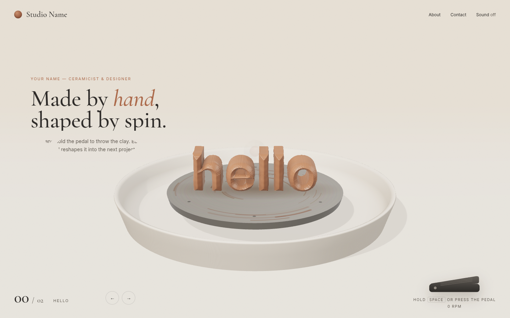

# AlHanouf Portfolio

A static portfolio for a ceramicist. The page is a potter’s wheel, drawn in the browser with three.js. The clay on the wheel begins as the word **hello**. Hold the foot pedal, or hold Space, and the wheel spins: the clay is pulled back into a lump, thrown into the next project’s shape, and the splatter off the wheel reveals that project’s words and images.

Two demo projects are included. Every name on the page is a placeholder.

- **Ridge Tea House** — graphic design. The clay becomes the tea-house mark.
- **Still Water Vessels** — ceramics. The clay becomes a thrown bottle.

**Live demo:** https://hamdihudhaidh.github.io/AlHanouf_Portfolio/



## Interaction

- **Pedal or Space.** Press and hold the foot pedal at the bottom of the screen, or hold Space, to spin the wheel and advance to the next project. Let go and the wheel slows.
- **Arrows.** The on-screen arrow buttons, and the Left and Right arrow keys, step backward and forward. Each step gives the wheel a short spin.
- **Morph.** The clay is one continuous form. It reshapes from the word hello, to the tea-house mark, to a vessel, and back to hello.
- **Splatter.** Titles, descriptions, project facts, and images are uncovered through splatter-shaped masks as the new form settles.
- **Also on the page.** About and Contact open from the header. Sound stays off until it is turned on. When the browser requests reduced motion, the wheel does not spin and the project changes with a crossfade.

There is no build step. Paths are relative, so the same files work from a local server or from `/AlHanouf_Portfolio/` on GitHub Pages.

## Folder structure

```
index.html                 page, header, pedal, About and Contact
css/style.css              layout and the splatter reveal
js/main.js                 scene, wheel, pedal, splatter, and UI
js/clay.js                 ray-marched clay; morphs hello, mark, and vessel
js/projects.js             the words and image list for each project
js/vendor/three.module.js  three.js r169, vendored (no CDN)
js/vendor/addons/          RoomEnvironment, for the studio lighting
assets/fonts/              self-hosted Cormorant Garamond and Inter
assets/img/                SVG project images and the favicon
.github/workflows/pages.yml  publish to GitHub Pages
```

## Edit the content

Open `js/projects.js` and edit the `PROJECTS` list. The first entry is the hello state. The next two are the demo projects, Ridge Tea House (`ridge`) and Still Water Vessels (`still`).

| Field | What to change |
| --- | --- |
| `label` | Name shown beside the counter while the wheel turns |
| `eyebrow`, `title`, `desc` | Text the splatter reveals. `title` can include `<em>` and `<br>` |
| `meta` | Pairs of `[label, value]`, or `null` when a stop has no facts |
| `images` | `[path, caption, class]`. Paths are relative to the site root |
| `shape` | Clay form: `0` hello, `1` tea-house mark, `2` vessel |
| `cls` | Layout class: `hello`, `p1`, or `p2` |

Images live in `assets/img/`. Replace a demo SVG, or add a file and point an `images` entry at it, for example `assets/img/p1-logo.svg`. Keep the paths relative.

The header name (“Studio Name”), the page title, and the About and Contact copy are the other placeholders. Those strings are in `index.html`.

## Run locally

Opening `index.html` with `file://` will not work: the page loads JavaScript as ES modules, and browsers block that from a file URL. Serve the folder instead:

```bash
python3 -m http.server
```

Then open http://localhost:8000.

## Tech

- **three.js r169**, self-hosted at `js/vendor/three.module.js` and loaded with an import map. Nothing is fetched from a CDN.
- **RoomEnvironment** (`js/vendor/addons/RoomEnvironment.js`) supplies the image-based lighting.
- The clay in `js/clay.js` is a ray-marched signed-distance field, so one lump can be reshaped into the next project while the wheel turns.
- **Cormorant Garamond** and **Inter** are self-hosted WOFF2 files in `assets/fonts/`.

## Browser

The wheel needs JavaScript, ES modules, import maps, and WebGL. A current Chrome, Edge, Firefox, or Safari is enough. There is no fallback canvas: without WebGL the wheel cannot render. A `<noscript>` note is shown when JavaScript is off.

## Credits and licences

- **three.js r169** — Copyright © 2010–2024 three.js authors. [MIT License](js/vendor/LICENSE-three.txt).
- **Inter** (weights 400, 500, and 800) — Copyright 2016 The Inter Project Authors. [SIL Open Font License 1.1](assets/fonts/LICENSE-Inter.txt).
- **Cormorant Garamond** (weight 500, roman and italic) — Copyright 2015 The Cormorant Project Authors. [SIL Open Font License 1.1](assets/fonts/LICENSE-Cormorant.txt).

## Deploy

`.github/workflows/pages.yml` publishes this repository with GitHub Actions on every push to `main`, and it can also be run by hand from the Actions tab. The live site is https://hamdihudhaidh.github.io/AlHanouf_Portfolio/.
